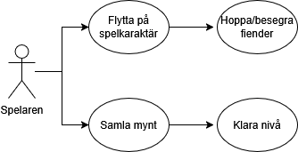

# Super Mario H3 – OOAD Dokumentation

## Analys

### Aktörer
- **Spelaren** – Styr Mario genom tangentbordet. Försöker samla mynt, undvika fiender och klara banan.

### Use Cases
- **Hoppa** – Spelaren trycker på mellanslag för att Mario ska hoppa.
- **Springa** – Mario rör sig åt höger/vänster via piltangenterna.
- **Samla mynt** – När Mario rör vid ett mynt plockas det upp och poängen ökar.
- **Slå fienden** – Om Mario hoppar på en fiende försvinner den och spelaren får poäng.
- **Förlora liv** – Om en fiende rör vid Mario förlorar Mario ett liv.

### Objekt
- **Mario** – Kan hoppa, springa och samla mynt.
- **Fiende** – Rör sig i spelet och kan skada Mario om han inte hoppar på den.
- **Plattform** – Yta som Mario kan stå på eller hoppa mellan.
- **Mynt** – Ger poäng när Mario plockar upp dem.
- **Liv** – Antalet chanser Mario har. När liven tar slut är spelet över.

## Design
Klassdiagram finns [här](https://github.com/EduEdugrade/net25-kurs-1-grupparbete-h3/blob/main/OOAD/Klassdiagram.drawio.png)
### Klass: Spelobjekt (bas)
**Beskrivning:** Grundklass för alla objekt i spelet.

**Attribut:**
- `float xPosition`
- `float yPosition`
- `string image`
- `Rectangle hitbox`

**Metoder:**
- `draw()` – Ritar objektet på skärmen
- `update()` – Uppdaterar objektets tillstånd

---

### Klass: MovableObject (ärver från Spelobjekt)

**Attribut:**
- `float speed`
- `bool isAlive`

**Metoder:**
- `move()`
- `checkBounds()`

---

### Klass: NonMovableObject (ärver från Spelobjekt)

**Metoder:**
- `interact(Mario mario)`

---

### Klass: Game

**Attribut:**
- `List<Spelobjekt> objects`

**Metoder:**
- `update()` – Uppdaterar rörelse, kollisioner och logik  
- `draw()` – Ritar alla objekt

---

### Klass: PowerUp (ärver från NonMovableObject)

**Attribut:**
- `string type` – (t.ex. Mushroom)  
- `int value` – hur mycket effekten påverkar Mario (+1 liv)  
- `float xPosition`  
- `float yPosition`

**Metoder:**
- `applyEffect(Mario mario)`
- `remove()`

---

### Klass: Mario (ärver från MovableObject)

**Attribut:**
- `int Score`
- `int Health`
- `float Speed`
- `float xPosition`
- `float yPosition`
- `Rectangle hitbox`
- `string image`

**Metoder:**
- `jump()`
- `moveLeft()`
- `moveRight()`
- `collectCoin()`
- `takeDamage()`

---

### Klass: Goomba (ärver från MovableObject)

**Attribut:**
- `float xPosition`
- `float yPosition`
- `float speed`
- `int damage`
- `Rectangle hitbox`
- `string image`

**Metoder:**
- `move()`
- `die()`
- `attackMario(Mario mario)`
- `checkCollision(Mario mario)`

---

### Klass: Mynt (ärver från NonMovableObject)

**Attribut:**
- `float xPosition`
- `float yPosition`
- `int value`
- `Rectangle hitbox`
- `string image`

**Metoder:**
- `collect(Mario mario)`  
---

### Klass: Plattform (ärver från NonMovableObject)

**Attribut:**
- `float xPosition`
- `float yPosition`
- `float width`
- `float height`
- `Rectangle hitbox`
- `string image`

**Metoder:**
- `bool supportMario(Mario mario)`

---

### Klass: Liv

**Attribut:**
- `int count`
- `int maxLives`

**Metoder:**
- `loseLife()`
- `gainLife()`
- `resetLives()`
