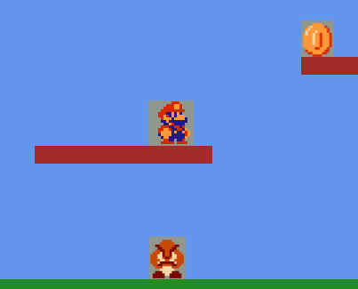
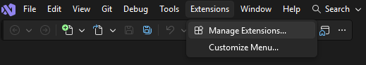
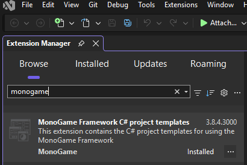
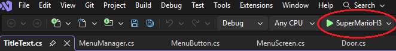

<<<<<<< HEAD
# .net25-oop-group
Grupparbete för första kursen
=======
# Super Mario H3
Det här projektet är grupp H3's försök till att återskapa det klassiska spelet Super Mario, utvecklad med hjälp av ramverket MonoGame.  

  
*Super Mario!*

## Installation
För att kunna köra spelet så behöver projektets källkod laddas ner och byggas med en kodeditor, samt ha MonoGames ramverk installerat.
Nedan följer en guide för hur man laddar ner spelets källkod och bygger projektet i Windows-miljö med Visual Studio 2026.  

För ett annat OS eller en annan kodeditor så hänvisar jag er till denna länk: [Getting Started MonoGame](https://docs.monogame.net/articles/getting_started/index.html)

### Visual Studio 2026

1. Ladda ner och installera [Visual Studio](https://visualstudio.microsoft.com/downloads/).
2. Starta Visual Studio och välj "Continue without code".
3. Välj fliken Extensions och klicka på Manage Extensions.
   
     
  
5. Skriv MonoGame i sökfältet och installera sedan MonoGame Framework C# project templates.
   
   
   
7. Avsluta Visual Studio efter MonoGame extension har installerats.
8. För att ladda ner projektet så klicka på den gröna "<> code" knappen längst upp i projektets [huvudsida](https://github.com/EduEdugrade/net25-kurs-1-grupparbete-h3) och välj Download as zip. 
9. Extrahera filerna till valfri plats och öppna [SuperMarioH3.sln](https://github.com/EduEdugrade/net25-kurs-1-grupparbete-h3/blob/main/SuperMarioH3.sln) med Visual Studio.
10. Klicka på Play!

    
  
## Hur du spelar
Spelet består av flera olika nivåer där spelaren ska ta sig till slutet av en nivå för att kunna ta sig vidare till nästa.   
Under spelets gång så ska spelaren undvika eller slå ut fiender, samla mynt och powerups. En fiende slås ut genom att spelaren hoppar på den. Skulle spelaren förlora alla sina liv så börjar spelet om från början.

### Demo
Denna demo version har endast en nivå och ett fåtal fiender.

### Kontroller  
- **Speldosa**
  - **Rörelse:** Styrkorset
  - **Hoppa:** A-knappen
  - **Öka hastighet**: X-knappen
- **Tangentbord**
  - **Rörelse:** WASD eller piltangenter
  - **Hoppa:** `Space`
  - **Öka hastighet:** `l-shift` / `B`
>>>>>>> b9f3b7276c0a96465ab4cb02e07527227fb4d190
